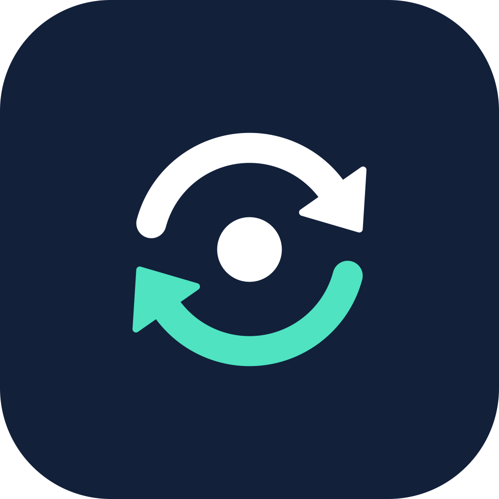
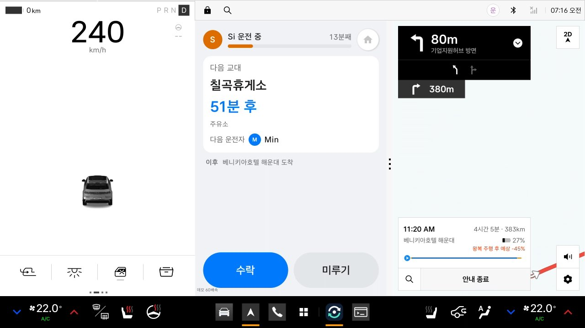
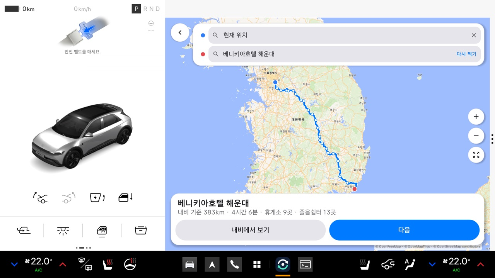
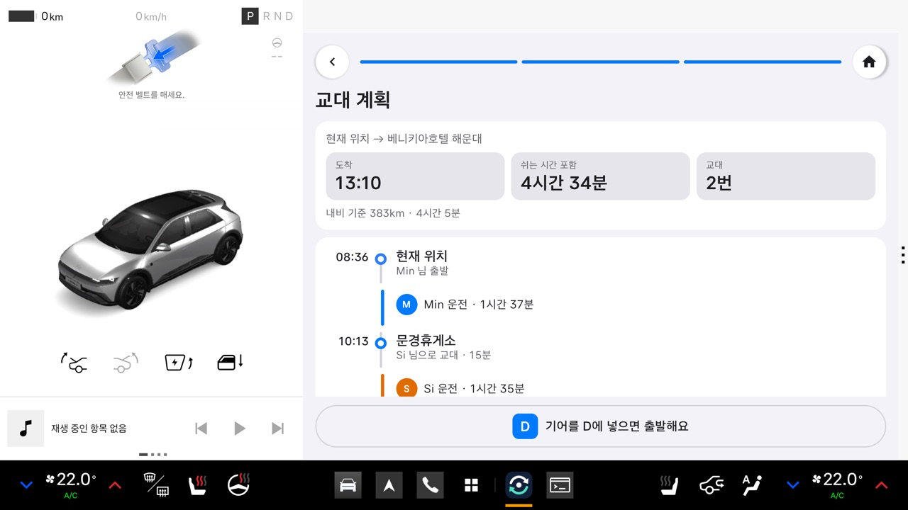
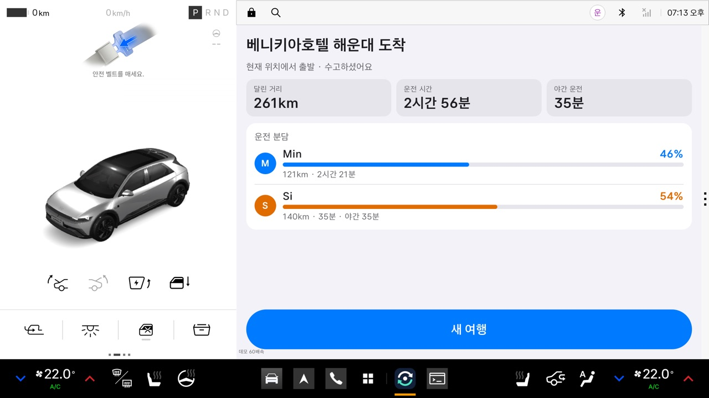
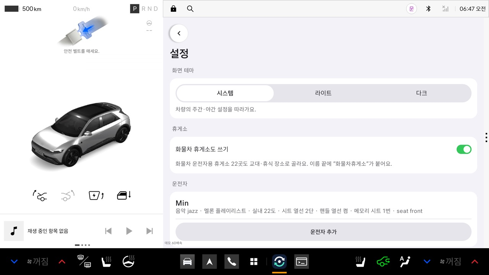

<p align="center"></p>

<h1 align="center">교대 플래너</h1>

<p align="center">장거리 운전을 여럿이 나눠 하는 차를 위한 Pleos 차량용 앱<br>
누가, 어느 휴게소에서, 언제 바꿔 앉을지 미리 정하고 달리는 동안 알려 줍니다.</p>

<p align="center"></p>

## 왜 만들었나

가족 여행이나 귀성길에서는 "다음 휴게소에서 바꿀까?"를 운전하면서 정합니다. 그러다 보면 휴게소를 지나치고,
한 사람이 몇 시간씩 연달아 운전하고, 야간 운전이 서툰 사람이 밤길을 맡게 됩니다.
교대 플래너는 내비가 고른 경로 위의 실제 휴게소를 보고 교대 계획을 세웁니다. 주행 중에는 다음 교대를 알려 주고,
교대할 때 다음 운전자의 시트·온도·열선 설정을 차에 한 번에 맞춥니다.

## 주요 기능

| 기능 | 설명 |
|---|---|
| **내비 경로 그대로 계획** | Pleos 내비에서 목적지를 찍고 경로 후보를 고르면, 앱이 그 경로의 휴게소·졸음쉼터 목록과 거리를 받아 계획을 세웁니다. 내비에서 다른 경로로 바꾸면 지도와 휴게소도 따라 바뀝니다. |
| **교대 계획** | 연속 운전 2시간(초보 1시간) 안에서 가장 먼 휴게소를 고르고, 교대마다 15분 쉬는 시간을 넣습니다. 야간 운전을 피하고 싶은 사람은 밤 구간에 넣지 않고, 남은 사람 중 운전을 덜 한 사람에게 맡깁니다. 혼자 운전하면 90분 안에서 쉬어 가도록 휴식 계획을 세웁니다. |
| **실제 휴게소 정보** | 한국도로공사 휴게소 공식 자료(일반 277곳, 화물차 22곳)로 이름과 편의시설(주유·LPG·전기차 충전·식당 등)을 보여 줍니다. 화물차 휴게소는 설정에서 켤 때만 씁니다. |
| **주행 중 안내** | 기어를 D에 넣으면 운전 시간 기록을 시작합니다. 다음 교대 휴게소, 남은 시간, 연속 운전 시간을 보여 줍니다. 내비 위에 작게 띄우거나 내비와 나란히 놓을 수 있습니다. |
| **수락하면 내비 경유지로** | 교대 10분 전에 음성으로 묻습니다. "응"이라고 하거나 버튼을 누르면 그 휴게소를 내비 경유지로 넣습니다. "미뤄 줘"라고 하면 다음 휴게소로 미룹니다. |
| **정체 대응** | 내비의 남은 시간이 계획보다 크게 늘면 교대 지점을 다시 계산해 제안합니다. |
| **운전자별 차량 설정** | 휴게소에서 P에 넣으면 교대 화면이 열리고, 다음 운전자의 메모리 시트(사이드미러 포함)·실내 온도·시트 열선·핸들 열선을 한 번에 맞춥니다. 등록한 플레이리스트가 있으면 틀지 물어봅니다. |
| **여행 요약** | 도착하면 사람마다 달린 거리·운전 시간·야간 운전을 비율로 보여 줍니다. |

## 화면

| 경로 확인 | 교대 계획 |
|---|---|
|  |  |
| 내비가 고른 경로와 그 위의 휴게소·졸음쉼터 | 누가 어디까지 운전하고 어디서 바꾸는지 |

| 여행 요약 | 설정 |
|---|---|
|  |  |
| 도착 후 운전 분담 | 화물차 휴게소 사용, 운전자별 차량 설정 |

## 설치와 실행

### APK로 설치

1. [Releases](../../releases) 페이지에서 `shift-planner-1.0.0.apk`를 받습니다.
2. Pleos Connect 에뮬레이터(v2.1.0 이상, arm64)를 켜고 설치합니다.

```bash
adb install -r shift-planner-1.0.0.apk
```

3. 앱을 처음 열면 차량 속도 권한을 묻습니다. 허용해야 운전 시간을 기록합니다.
4. 설정 화면에서 "다른 앱 위에 표시"를 켜면, 내비가 앱을 덮을 때 다음 교대가 내비 위에 작게 뜹니다.

> 출시 APK는 실제 시간으로 돌아갑니다. 에뮬레이터에서 빠르게 보려면 아래처럼 디버그 빌드(60배속)를 쓰세요.

### 사용 순서

1. **새 여행**에서 목적지를 고르고 **내비에서 보기**로 Pleos 내비에서 경로를 고릅니다.
2. 운전자 수와 이름, 초보·야간 회피 여부를 넣으면 교대 계획이 나옵니다.
3. 기어를 D에 넣고 달립니다. 에뮬레이터에서는 Virtual Console이나 `tools/vhal.sh gear D`, `tools/vhal.sh speed 100`을 씁니다.
4. 교대 휴게소에 도착해 기어를 P에 넣으면 교대 화면이 열립니다.

### 소스에서 빌드

- Android Studio 또는 JDK 21, Gradle 8 이상
- Android API 34 이상(Pleos Connect 에뮬레이터 v2.1.0)

```bash
./gradlew :app:testDebugUnitTest   # 단위 테스트 72개
./gradlew :app:assembleDebug       # 디버그 빌드(60배속 데모)
./gradlew :app:assembleRelease     # 출시 빌드(실제 시간)
tools/emulator.sh                  # Pleos Connect 에뮬레이터 실행
tools/run.sh                       # 빌드·설치·실행
```

## 쓰는 Pleos SDK

| SDK | 용도 |
|---|---|
| Navi SDK (NaviHelper 3.0.5) | 목적지 검색, 경로 후보·회전 안내에서 휴게소 목록 받기, 남은 거리·시간, 경유지 추가·삭제 |
| Vehicle SDK 2.3.2 | 기어(P/R/N/D), 메모리 시트, 실내 온도, 시트·핸들 열선 |
| TTS / STT | 교대 안내 음성(ON_DEVICE), "응·미뤄 줘" 음성 대답 |
| 표준 차량 API | 차량 속도(`PERF_VEHICLE_SPEED`) |

## 구조

```
app/src/main/java/com/pleoscontest/app/
├─ shift/     교대 규칙 엔진 (화면·차량과 분리한 순수 Kotlin, 단위 테스트 대상)
│  ├─ ShiftPlanner      경로·운전자 → 구간별 운전자와 교대 휴게소
│  ├─ ExpresswayNetwork 전국 고속도로망에서 내비 휴게소를 이어 경로 선 만들기
│  ├─ NaviRouteStops    내비 회전 안내에서 휴게소·졸음쉼터 뽑기
│  └─ TripTracker       운전 시간·거리 기록, 내비 남은 거리로 위치 맞추기
├─ navi/      Pleos 내비 연동
├─ vehicle/   기어·속도 (Pleos / 표준 차량 API / 목 데이터 자동 선택)
├─ voice/     음성 안내와 대답 듣기
└─ ui/        Jetpack Compose 화면, 주행 중 알림 서비스
```

- 위치정보 권한은 쓰지 않습니다. 위치와 경로는 내비가 알려 주는 남은 거리·시간으로만 맞춥니다.
- 운전자 이름과 설정은 차 안에만 저장합니다. 밖으로 나가는 것은 지도 타일 요청, 짧은 일반도로 경로 미리보기(OSRM), 장소 검색어(Photon)뿐이며 이름·차량 정보는 보내지 않습니다.

## 데이터 출처

자세한 내용과 라이선스는 [NOTICE.md](NOTICE.md)에 있습니다.

- 고속도로망·휴게소 위치: © OpenStreetMap contributors (ODbL 1.0). 앱에 들어간 [`expressway.tsv`](app/src/main/resources/expressway.tsv)도 ODbL을 따릅니다.
- 휴게소 이름·편의시설: 한국도로공사 「전국휴게소정보표준데이터」, 공공데이터포털 (이용허락범위 제한 없음)
- 지도: OpenFreeMap, OpenMapTiles, Natural Earth, MapLibre
- 경로 미리보기·장소 검색: OSRM, Photon (OpenStreetMap 기반)
